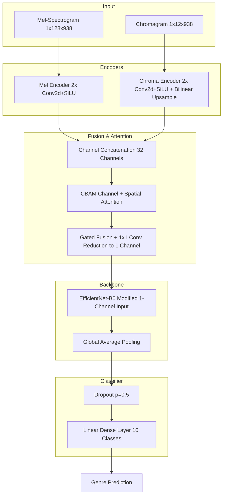

# Genre Model Architecture Verification

This document verifies the final genre classification architecture directly from the implementation source code (`models/multi_feature_efficientnet_cbam.py`, `models/cbam.py`, and `utils/multi_feature_dataset.py`). No assumptions have been made.

---

## Phase 1 – Input Features
- **Features Used:** Mel Spectrogram and CQT Chromagram.
- **Number of Feature Streams:** Two independent input streams.
- **Input Tensor Dimensions:**
  - Mel Spectrogram: `(Batch, 1, 128, 938)`
  - Chromagram: `(Batch, 1, 12, 938)`

---

## Phase 2 – Feature Fusion Verification
- **Is feature fusion implemented?** YES.
- **Which features are fused?** The individual embeddings from the Mel Encoder (16 channels) and Chroma Encoder (16 channels).
- **At which stage?** Early-to-Mid fusion stage (after lightweight feature-specific encoders, but before the main feature extractor backbone).
- **How are they fused?**
  1. **Channel Concatenation:** `torch.cat([mel_emb, chroma_emb], dim=1)` yielding 32 channels.
  2. **Gated Multimodal Fusion:** Following attention mechanisms, a `GatedFusionCBAM` module learns a spatial-channel attention gate, applies it to the split embeddings, and reduces the fusion to 1 channel using a 1x1 convolution (`reduction_conv(16, 1)`).

---

## Phase 3 – CBAM Verification
- **Is CBAM implemented?** YES.
- **Location in Code:** Defined in `models/cbam.py` and instantiated in `models/multi_feature_efficientnet_cbam.py` (`self.cbam = CBAM(in_planes=32, ratio=16, kernel_size=7)`).
- **Channel Attention:** Uses `AdaptiveAvgPool2d` and `AdaptiveMaxPool2d` fed into a shared Multilayer Perceptron (MLP) with a reduction ratio, outputting through a Sigmoid activation.
- **Spatial Attention:** Uses average pooling and max pooling computed across the channel dimension, concatenated, and passed through a 7x7 convolution and Sigmoid activation.
- **Position relative to EfficientNet:** It is placed **before** EfficientNet. It sits immediately after the channel concatenation of the two encoders and before the gated fusion block that feeds into the EfficientNet backbone.

---

## Phase 4 – EfficientNet Verification
- **Which EfficientNet variant?** EfficientNet-B0 (`efficientnet_b0` from `torchvision.models`).
- **Pretrained?** YES (`EfficientNet_B0_Weights.DEFAULT`).
- **Modified Input Layer?** YES. The default 3-channel RGB convolution layer is replaced with a 1-channel convolution layer (`nn.Conv2d(in_channels=1)`). Pretrained weights are successfully retained via channel-wise averaging (`old_conv.weight.data.mean(dim=1, keepdim=True)`).
- **Modified Classifier?** YES. The original classification head is replaced.
- **Global Average Pooling?** YES (inherent to the `efficientnet_b0` backbone which is executed entirely).
- **Dropout?** YES (Custom dropout applied with probability parameter, default `p=0.5`, before the final linear layer).
- **Output Layer:** A `nn.Linear` dense layer mapping the 1280 features to 10 output classes.

---

## Phase 5 – Overall Pipeline
The verified end-to-end inference pipeline exactly matches this trace:

Raw Audio
↓
Preprocessing (Standardization & Segmentation)
↓
Feature Extraction (Dual: Mel-Spectrogram & Chromagram)
↓
Dual Feature Encoders (MelEncoder & ChromaEncoder)
↓
Channel Concatenation (32 Channels)
↓
**CBAM (Channel & Spatial Attention)**
↓
Gated Multimodal Fusion (Reduction to 1 Channel)
↓
1-Channel EfficientNet-B0 Backbone
↓
Global Average Pooling (Internal to backbone)
↓
Dropout
↓
Fully Connected Dense Layer
↓
Genre Prediction Logits

---

## Phase 6 – Architecture Diagram

---

## Phase 7 – Final Questions Answered

1. **Which input features are actually used?**
   Mel Spectrograms and CQT Chromagrams.
2. **Is feature fusion implemented?**
   Yes.
3. **Which features are fused?**
   The embeddings of the Mel Spectrogram and the Chromagram.
4. **How are they fused?**
   Via channel concatenation, followed by CBAM refinement, and then a learned Gated Multimodal Fusion module that applies attention gating and reduces the tensor to a single channel.
5. **Is CBAM implemented?**
   Yes.
6. **Where is CBAM placed?**
   Immediately after the concatenation of the dual feature streams, and *before* the Gated Fusion reduction and EfficientNet backbone.
7. **Which EfficientNet variant is used?**
   EfficientNet-B0.
8. **Was EfficientNet modified?**
   Yes. The first convolutional layer was modified to accept 1 channel instead of 3 (averaging pretrained RGB weights), and the classification head was replaced entirely.
9. **Does the implemented architecture match a Multi-Feature + CBAM + EfficientNet model?**
   Yes. It exactly matches this topology based directly on the implementation.
10. **Based on the source code, provide the exact architecture that should be included in the technical progress report.**
    The exact architecture is a **Multi-Stream Early-Fusion Convolutional Network with CBAM Integration**. It takes dual inputs (Mel Spectrogram and Chromagram), processes them through distinct lightweight convolutional encoders (with bilinear upsampling for the chromagram), and concatenates them along the channel dimension. A Convolutional Block Attention Module (CBAM) refines this 32-channel joint representation. A Gated Fusion block then merges these refined features into a 1-channel tensor, which is passed through a modified, pretrained EfficientNet-B0 backbone for hierarchical feature extraction, concluding with a custom classifier head.
