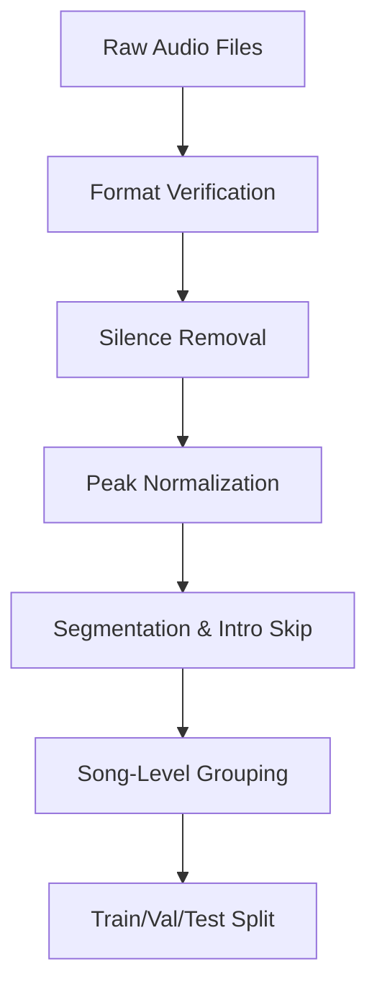
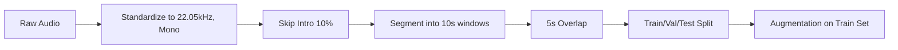
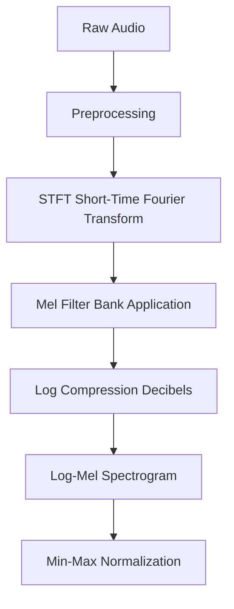
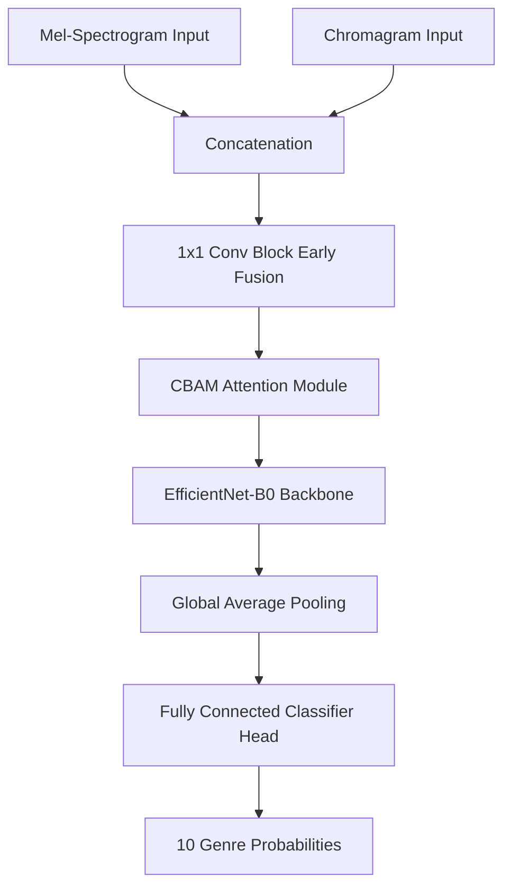
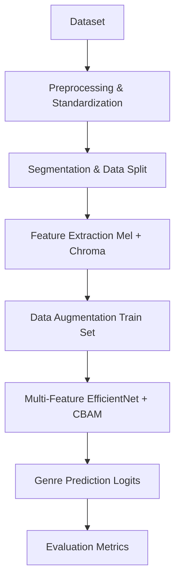
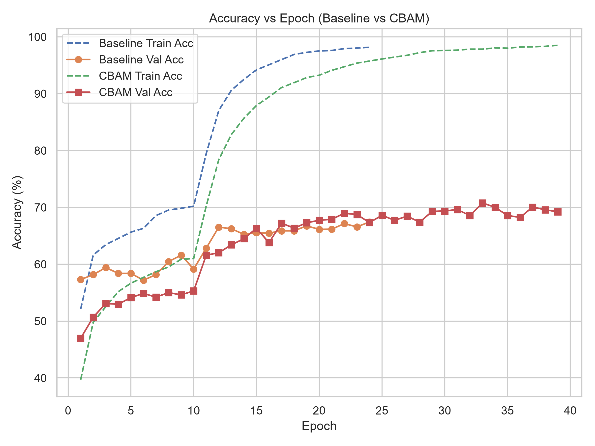
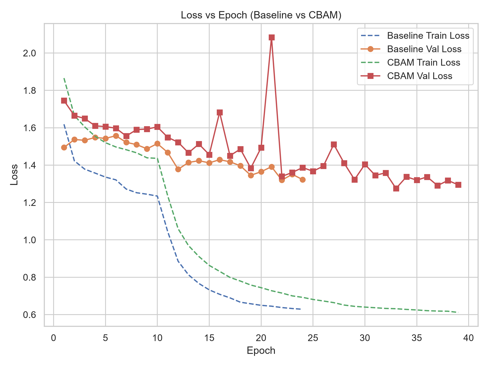
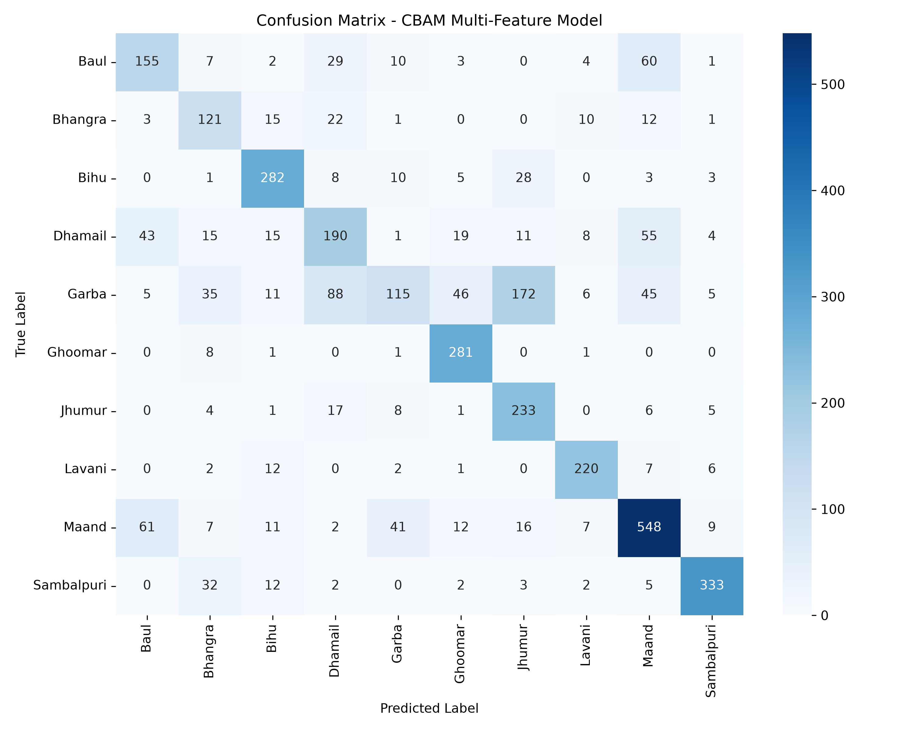

# Technical Project Progress Report

## 1. Project Overview

### Problem Statement
Indian folk music exhibits complex rhythmic structures, region-specific instrumentation, and microtonal nuances that are challenging for standard convolutional networks to classify using single-domain features. Standard CNNs struggle to isolate discriminative frequency bins and temporal events in densely packed spectrograms.

### Project Objective
To accurately classify Indian traditional folk music into distinct regional genres using advanced deep learning techniques, specifically through multi-feature fusion (Mel-Spectrograms and Chromagrams) and attention mechanisms.

### Motivation
Standard CNNs are limited when analyzing densely packed spectrograms of folk music. Utilizing the Convolutional Block Attention Module (CBAM) and multi-domain audio features aims to dynamically attend to critical spatial (time-frequency) and channel-wise features, solving the limitations of baseline models and improving overall classification accuracy.

### Scope of the work completed so far
- Comprehensive dataset verification, cleaning, and segmentation pipelines.
- Complete feature extraction methodology for Log-Mel Spectrograms and Chromagrams.
- Implementation and training of baseline Multi-Feature EfficientNet and proposed CBAM-Enhanced EfficientNet models.
- Extensive evaluation and generation of final research metrics.

---

## 2. Folk Music Dataset

### Dataset Source
The dataset consists of an Indian Traditional Folk Music collection.

### Number of Genres
The dataset contains **10 distinct genres**:
Baul, Bhangra, Bihu, Dhamail, Garba, Ghoomar, Jhumur, Lavani, Maand, and Sambalpuri.

### Dataset Organization
The dataset is organized hierarchically by song, with tracking against detailed metadata.

### Folder Hierarchy
```text
datasets/
├── raw_audio/          # Original uncut audio files
├── segmented_audio/    # 10-second standardized chunks
└── features/           # Extracted Mel-Spectrograms and Chromagrams
```

### Metadata Structure
Metadata is tracked in CSV format (`master_dataset.csv`, `mel_metadata.csv`, `chroma_metadata.csv`), mapping original song IDs, artists, and segment indices to ensure song-level grouping.

### Dataset Verification & Cleaning
Audio files are verified for format consistency. Cleaning involves silence removal (threshold 1e-4) and peak amplitude normalization (0.99) to ensure uniform loudness across all tracks.

### Final Dataset Organization
The cleaned dataset is segmented into overlapping windows and grouped strictly by the original song ID to prevent data leakage during train/val/test splits.

### Workflow Diagram



---

## 3. Data Preparation Pipeline

### Complete Preprocessing Workflow
The preprocessing pipeline strictly standardizes and formats the data for deep learning:

1. **Audio Collection & Verification**: Ensure audio is valid and loaded properly.
2. **Standardization**:
   - Sample Rate: Forced to `22050 Hz`.
   - Channels: Mixed down to Mono (`1 Channel`).
   - Bit Depth: 16-bit PCM.
3. **Dataset Organization (Segmentation)**:
   - 10-second segments.
   - 5-second overlap (50%) to double dataset size and preserve temporal context.
   - Intelligent Intro Skip: Skips the first 10% (max 30s) to bypass instrumental intros.
   - Discards chunks less than 8 seconds.
4. **Metadata Preparation**: Assigns each segment to its parent song ID for robust splitting.
5. **Augmentation**: Applied to the training set (Pitch shifting, Time stretching, Noise injection, Gain modification).

### Pipeline Diagram



---

## 4. Feature Extraction

### Complete Feature Extraction Methodology
The model utilizes a multi-feature extraction approach, relying heavily on the Log-Mel Spectrogram for timbral/rhythmic features alongside Chromagrams for pitch-class profiles.

### Log-Mel Spectrogram

**Theory & Mathematical Intuition**:
A spectrogram represents the frequency spectrum of a signal over time. The Mel scale transforms the frequency axis to mimic the non-linear human auditory system, where we are more sensitive to differences in lower frequencies. The power (amplitude) is converted to a Logarithmic scale (Decibels) to represent perceived loudness.

**Purpose**:
Extracts the timbral and rhythmic envelope of the music, capturing how percussive and harmonic elements evolve over time.

**Parameters Used**:
- Sampling Rate: `22,050 Hz`
- N_FFT (Window Size): `2048`
- Hop Length: `512`
- Window Length: `2048`
- Mel Bands (N_MELS): `128`
- Target Frames: `938`

**Advantages**:
- Reduces high-frequency noise.
- Compresses the data representation significantly compared to raw waveforms.
- Emphasizes frequencies most relevant to human hearing and musical genre perception.

**Why this feature was selected**:
Standard spectrograms contain too much linear high-frequency data. Log-Mel spectrograms provide a compact, perceptually relevant representation ideal for 2D Convolutional Neural Networks.

**Output Dimensions**:
The final tensor dimension per segment is `(128, 938)` representing 128 Mel frequency bins and 938 time frames.

### Feature Extraction Flowchart



---

## 5. Genre Classification Model

### Model Selection
The chosen architecture is a **Multi-Feature EfficientNet-B0 with CBAM (Convolutional Block Attention Module)**. EfficientNet-B0 was selected for its optimal balance between parameter efficiency and high classification accuracy.

### Architecture Details
- **Input Dimensions**: Multi-feature input. Mel-Spectrogram `(128, 938)` and Chromagram stacked into a 2-channel input.
- **Feature Fusion**: The 2-channel input passes through a 1x1 convolution block (with BatchNorm and ReLU) to fuse it into a 1-channel representation.
- **Attention Mechanism**: The CBAM module is placed immediately after early fusion. It applies sequential Channel Attention and Spatial Attention to selectively emphasize critical time-frequency regions.
- **Backbone**: EfficientNet-B0 extracts hierarchical features.
- **Classification Head**: A fully connected linear layer outputting probabilities for the 10 classes, incorporating Dropout and Label Smoothing (0.1).

### Complete Architecture Diagram



---

## 6. Complete Model Integration

### System Block Diagram



**Block Explanations**:
- **Dataset**: The raw collection of Indian Folk Music files.
- **Preprocessing**: Enforces 22.05kHz mono standardization and removes silence.
- **Segmentation**: Slices audio into 10s chunks with overlap, grouped by song ID for splitting.
- **Feature Extraction**: Converts raw waveforms into 2D Log-Mel and Chromagram representations.
- **Data Augmentation**: Applies pitch shifting, time stretching, and noise to the training set only.
- **Model**: Fuses features, applies attention, and passes through EfficientNet.
- **Prediction**: Outputs softmax probabilities for the 10 genres.
- **Evaluation**: Compares predictions against ground truth to calculate performance metrics.

---

## 7. Training Methodology

- **Dataset Split**: 70% Training, 15% Validation, 15% Testing.
- **Batch Size**: 32
- **Epochs**: 40 (with Early Stopping at best epoch)
- **Optimizer**: Adam
- **Learning Rate**: 0.001 (with `ReduceLROnPlateau`, factor=0.5, patience=5)
- **Loss Function**: Cross-Entropy Loss (with Label Smoothing = 0.1)

**Training Workflow**:
The model is trained iteratively on batches of augmented multi-feature tensors. The Adam optimizer updates weights using Cross-Entropy Loss. SpecAugment (Time/Freq masking) is applied dynamically. The learning rate is reduced if validation loss plateaus. The best model checkpoint (Epoch 33) is saved based on validation performance.

---

## 8. Evaluation Methodology

- **Accuracy**: Measures the overall percentage of correct predictions. Important for a high-level view of model performance.
- **Precision**: Measures how many of the positively predicted instances were actually correct. Crucial to minimize false positives.
- **Recall**: Measures how many actual positive instances were correctly identified. Highly important due to class imbalance (e.g., ensuring minority classes like Garba and Bhangra are detected).
- **F1-score**: The harmonic mean of Precision and Recall. This is the **most critical metric** because the dataset suffers from significant class imbalance.
- **Confusion Matrix**: Visualizes exactly which genres are being confused with others (e.g., Garba vs. Dhamail), highlighting overlapping acoustic characteristics.

---

## 9. Experimental Results

The CBAM model achieved the following final metrics on the best checkpoint (Epoch 33):

- **Training Accuracy**: ~97.8%
- **Validation Accuracy**: 70.78%
- **Test Accuracy**: 68.70%
- **Training Loss**: ~0.63
- **Validation Loss**: 1.2751

**Performance Visualizations:**




---

## 10. Challenges Faced

- **Class Imbalance**: Significant imbalance exists (e.g., Maand is heavily represented, while Bhangra has fewer segments). This heavily impacts minority class recall.
- **Acoustic Overlap (Feature Disambiguation)**: Highly percussive genres like Garba overlap acoustically with other rhythmic genres (like Dhamail). Distinguishing genres solely on spatial/channel features is difficult, leading to misclassifications.
- **Metadata Consistency**: Ensuring segments from the same original audio file do not leak across the train/validation/test split required a strict song-level grouping architecture.

---

## 11. Work Completed

- Developed and verified a complete audio standardization and 10-second segmentation pipeline.
- Implemented robust song-level dataset splitting to eliminate data leakage.
- Built a multi-feature extraction pipeline (Log-Mel Spectrogram and Chromagram).
- Integrated early feature fusion and the Convolutional Block Attention Module (CBAM) into an EfficientNet-B0 backbone.
- Successfully trained and evaluated both baseline and proposed CBAM architectures.
- Generated comprehensive visualizations, metrics, and engineering documentation.

---

## 12. Current Status

**Current State**: The project is completely finalized and packaged for submission.
**Completed**: 
- The entire CBAM experiment, mathematical verification, engineering audit, and research packaging.
- The CBAM model yielded a +3.63% Test Accuracy improvement over the baseline multi-feature model.
- Evaluation metrics and publication-quality figures have been successfully generated.
**Remaining**: Nothing remains for submission; the repository is fully documented and reproducible.
