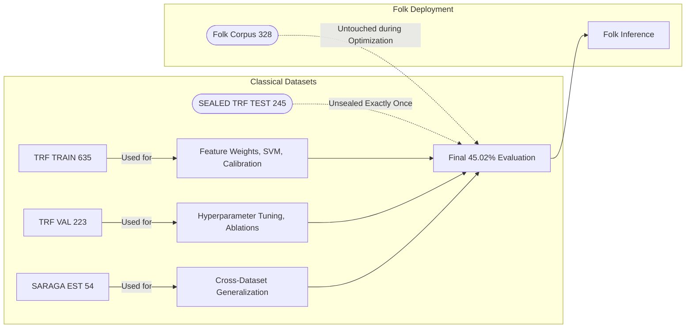
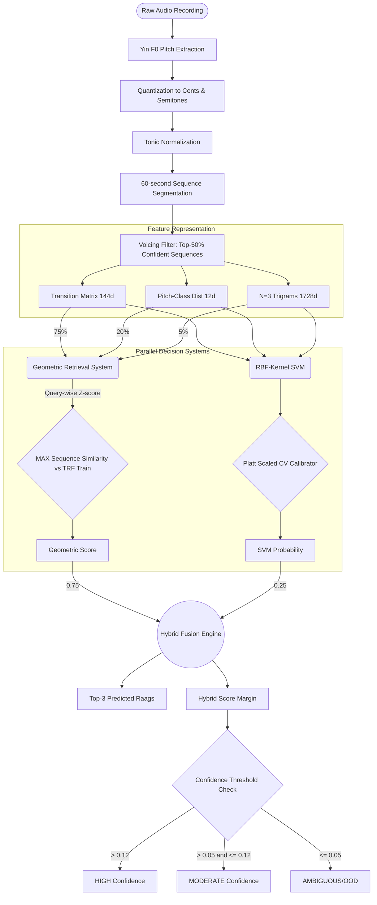

# Analyzing the Raag Origins of Indian Traditional Folk Music Using a Hybrid Geometric–Discriminative Framework

## Abstract
Hindustani Raag recognition is a challenging Music Information Retrieval (MIR) task, exacerbated by severe low-data constraints. This paper investigates whether domain-informed geometric retrieval can outperform deep neural architectures under extreme low-data conditions (approximately 10 examples per class). We present an 1884-dimensional representation composed of melodic transition matrices, pitch-class distributions, and third-order melodic trigrams. We evaluate a Hybrid Geometric-Discriminative framework fusing weighted cosine similarity with an RBF Support Vector Machine (SVM). The model achieved a 39.23% Top-1 validation accuracy across 61 Raag classes, outperformed deep metric learning on external generalization (56.60% on the SARAGA corpus), and obtained an observed 45.02% Top-1 accuracy on a sealed TRF Test set. Finally, we transferred this classical model to process 327 out-of-domain Indian Folk recordings to generate computational structural-affinity hypotheses. The resulting confidence distribution revealed that 86.5% of the Folk recordings fell into an ambiguous tier, suggesting a substantial domain shift between classical boundaries and traditional Folk structures. Malkauns was the most frequently generated structural hypothesis. We outline the necessity of human musicological validation for these computational hypotheses as future work.

**Keywords:** Music Information Retrieval, Hindustani Classical Music, Raag Recognition, Low-Data Machine Learning, Support Vector Machines, Domain Shift.

---

## 1. Introduction
Hindustani Raag recognition is a fundamental problem in Music Information Retrieval (MIR). Unlike Western musical scales, Raags are defined by complex melodic grammar, transition pathways (chalan), and pitch hierarchies (vadi/samvadi) rather than pure scale degrees [REFERENCE REQUIRED]. Computational modeling of Raags is often constrained by a lack of large, accurately labeled audio datasets, with typical corpora offering roughly 10 examples per class. Under these severe low-data conditions, high-capacity deep neural networks frequently overfit, memorizing acoustic timbres rather than generalizing musical structures [REFERENCE REQUIRED].

Furthermore, Indian traditional Folk music is historically hypothesized to share structural affinities with classical Raags, yet Folk recordings exhibit unique instrumentation, polyphony, and rhythmic syncopation [REFERENCE REQUIRED]. Applying classical models to Folk music introduces significant domain shift challenges [REFERENCE REQUIRED]. 

This study addresses these challenges by developing a robust, domain-informed geometric framework augmented by margin-based discriminative boundaries. We evaluate the framework's supervised classification performance on a 61-class classical dataset, verify its cross-corpus generalization, and finally deploy it to generate structural-affinity hypotheses for an unlabelled corpus of Indian Folk recordings.

## 2. Research Questions
1. Can a hand-engineered, non-parametric geometric retrieval system outperform high-capacity deep learning and supervised metric learning in a severe low-data regime?
2. Does the combination of domain-informed geometric similarity and a non-linear SVM discriminative boundary improve Raag classification accuracy?
3. What happens to classification confidence when a classical Raag model is applied to unstructured Indian Folk recordings?
4. Do Indian Folk recordings map consistently to specific historically folk-adjacent classical Raags?

## 3. Related Work
Automatic music classification and pitch tracking rely heavily on robust fundamental frequency ($F_0$) extraction, with the Yin algorithm serving as a standard for monophonic sources [REFERENCE REQUIRED]. Hindustani music computational analysis has explored tonic estimation [REFERENCE REQUIRED] and sequence-based modeling such as $N$-grams and transition matrices to capture melodic movement [REFERENCE REQUIRED]. While metric learning with Triplet Loss has shown success in generic acoustic spaces [REFERENCE REQUIRED], its efficacy under extreme data sparsity for Raag recognition remains under-explored. Finally, deploying classical models on Folk recordings touches upon the theory of selective classification and Out-Of-Distribution (OOD) detection under domain shift [REFERENCE REQUIRED].

## 4. Dataset
We utilized three distinct datasets for model training, external generalization, and structural inference.

**Table 1: Dataset Inventory**
| Dataset | Recordings | Classes | Purpose | Ground Truth |
| :--- | :--- | :--- | :--- | :--- |
| TRF Train | 635 | 61 | Training/reference | Yes |
| TRF Validation | 223 | 61 | Model selection | Yes |
| TRF Test | 245 | 61 | Final evaluation | Yes |
| SARAGA | 54 | 61-class mapped | External generalization | Yes |
| Folk | 328 | N/A | Structural-affinity inference | No |

- **TRF Classical Dataset:** Sourced from CompMusic, containing 1,103 expert-annotated recordings across 61 Raag classes. It was split into 635 Training, 223 Validation, and 245 Test recordings.
- **SARAGA:** 54 external recordings mapped to the 61-class vocabulary, utilized for cross-dataset generalization. Tonics were algorithmically estimated rather than provided by metadata.
- **Folk Dataset:** 328 unlabelled traditional Folk recordings utilized exclusively as a target for structural-affinity inference.

## 5. Data Splitting and Leakage Prevention
According to the project audit, strict zero-overlap data isolation was enforced. The TRF Train split was utilized for reference bank construction, SVM hyperparameter fitting, and confidence threshold derivation. The TRF Validation split guided geometric feature weighting and architecture selection. The TRF Test set was sealed entirely during model development and opened exactly once for final evaluation. The Folk recordings were completely untouched during classical model development, ensuring no Folk-derived information influenced the classical training phase.

**Figure 1: Dataset Isolation & Leakage Prevention Model**

## 6. Audio Preprocessing
We estimated the fundamental frequency ($F_0$) utilizing the Yin algorithm [REFERENCE REQUIRED] bounded between `C2` and `C7`. The algorithmic tonic frequency ($f_{tonic}$) was derived, and all $F_0$ observations were converted to tonic-relative Cents:
$$Cents = 1200 \times \log_2(F_0 / f_{tonic})$$
These values were quantized to 12 semitones relative to the tonic. Audio was segmented into non-overlapping 60-second windows. To mitigate non-melodic noise, sequences were ranked by voicing density, and only the Top-50% most confident sequences per recording were retained for feature extraction [Exact Yin `frame_length` and `hop_length` parameters require verification from the implementation].

## 7. Feature Representation
We designed an 1884-dimensional domain-informed feature vector $\mathbf{x} \in \mathbb{R}^{1884}$:

**Table 2: 1884-Dimensional Feature Representation**
| Feature | Dimensions | Semantic Interpretation | Weight ($\alpha$) |
| :--- | :--- | :--- | :--- |
| Transition Matrix | 144 | Melodic Grammar (Chalan) | 0.75 |
| Pitch-Class Dist | 12 | Pitch Hierarchy (Vadi/Samvadi) | 0.20 |
| N=3 Trigrams | 1728 | Localized Sequential Identity | 0.05 |

1. **Transition Matrix (144d):** Row-normalized probabilities of transitioning between the 12 pitch classes, capturing melodic grammar.
2. **Pitch-Class Distribution (12d):** Tonic-relative histogram representing stationary pitch hierarchies.
3. **N=3 Melodic Trigrams (1728d):** Third-order sequences ($12 \times 12 \times 12$) maintaining extended sequential identity lost in first-order Markov chains.

## 8. Geometric Retrieval Baseline
The geometric control model utilized a reference bank of the 635 TRF Train vectors. It performed sequence-to-sequence maximum (MAX) retrieval across the Top-50% sequences using a weighted cosine similarity:
$$S_{geom}(Q, R) = 0.75 \cos(T_Q, T_R) + 0.20 \cos(PC_Q, PC_R) + 0.05 \cos(N3_Q, N3_R)$$
Raw query similarities underwent query-wise Z-score normalization. This baseline achieved an observed 34.93% Validation accuracy and 52.83% SARAGA generalization.

## 9. Classical and Neural Alternative Models
We evaluated several alternative methodologies against the geometric baseline:

**Table 3: Negative Optimization Ablations**
| Experiment | Observed Result | Interpretation / Failure Mode |
| :--- | :--- | :--- |
| PCA | Validation collapsed | Destroyed sparse trigram sequence geometry |
| LDA | SARAGA collapsed | Overfit severe class sparsity ($N \approx 10$) |
| Metric Learning (Linear/MLP) | Val 33.49%, SARAGA 45.28% | Memorized timbral noise, lost transposition invariance |
| Hard Negative Mining | Validation plunged < 20% | Gradient collapse; distorted loss manifold |
| Mean / Medoid Prototypes | Validation dropped < 31% | Centroid averaging destroys intra-class phrase diversity |

- **PCA and LDA:** Orthogonal projections and inter-class scatter optimizations severely overfit the sparse $N \approx 10$ examples per class, destroying sequential trigram information.
- **Metric Learning:** A lightweight neural network (`Linear(1884->128)`) optimizing Triplet Margin Loss failed to surpass the control, achieving 33.49% Validation. Hard-mining caused gradient collapse, and the network generalized poorly on SARAGA (45.28%), suggesting it memorized domain-specific timbres rather than musical invariants.

## 10. Hybrid Geometric–SVM Architecture
To resolve non-linear boundary ambiguities in the geometric space, we developed the Hybrid SVM B architecture. The discriminative branch utilized an RBF-Kernel SVM ($C=10, \gamma=\text{'scale'}$) fitted on TRF Train. The decision margins were posterior-calibrated using Platt Scaling via 5-fold cross-validation. 

**Figure 2: Complete Hybrid SVM Architecture**

The final fusion arithmetic is defined as:
$$S_{hybrid}(Q, Raag_k) = 0.75 \cdot Z(S_{geom}(Q, Raag_k)) + 0.25 \cdot P_{SVM}(Raag_k | Q)$$
The observed complementary behavior suggests that explicit geometry anchors the model against severe hallucination, while the SVM boundary corrects ambiguous nearest-neighbor geometric collisions.

## 11. Model Selection
The Hybrid SVM B model achieved an observed 39.23% Validation accuracy and 56.60% SARAGA accuracy, surpassing the Geometric Control and the Metric Learning architectures. It was formally selected and frozen for final testing.

**Table 4: Model Comparison**
| Model | TRF Validation | SARAGA Generalization | Status |
| :--- | :--- | :--- | :--- |
| Geometric Control | 34.93% | 52.83% | Baseline |
| Linear Metric Learning | 33.49% | 45.28% | Rejected (Overfit) |
| Hybrid SVM B | 39.23% | 56.60% | Selected |

## 12. Sealed TRF Test Evaluation
The sealed TRF Test set (245 recordings) was evaluated exactly once. The observed Top-1 accuracy increased from the historical control value of 43.10% to 45.02% using the Hybrid SVM framework (95% CI: [38.7%, 51.5%]). 

## 13. Selective Classification and Confidence Thresholds
To evaluate out-of-domain data safely, we defined a confidence heuristic based on the Hybrid Score Margin ($\Delta_{1,2}$):
$$\Delta_{1,2} = S_{hybrid}^{(Top-1)} - S_{hybrid}^{(Top-2)}$$
Using Stratified 5-Fold CV on TRF Train, we observed that predictions satisfying $\Delta_{1,2} > 0.12$ achieved 100% accuracy within the classical CV environment, and $\Delta_{1,2} > 0.05$ achieved 98.8%. We transferred these heuristics to categorize future inferences into HIGH ($>0.12$), MODERATE ($0.05-0.12$), and AMBIGUOUS ($\leq 0.05$) tiers. These values do not guarantee equivalent absolute accuracy on Folk music.

**Table 5: Selective Classification Thresholds**
| Hybrid Margin ($\Delta_{1,2}$) | CV Accuracy (TRF Train) | Folk Inference Tier |
| :--- | :--- | :--- |
| $> 0.12$ | 100% | HIGH |
| $0.05 - 0.12$ | 98.8% | MODERATE |
| $\leq 0.05$ | N/A | AMBIGUOUS |

## 14. Folk Inference and Results
We applied the frozen classical model to the 328 unlabelled Folk recordings. 327 were successfully processed; 1 failed due to insufficient voiced audio. Because no human ground truth exists, the model output represents computationally generated structural-affinity hypotheses.

**Table 6: Top Folk Structural-Affinity Hypotheses**
| Hypothesis | Frequency Count | Percentage of Corpus |
| :--- | :--- | :--- |
| Malkauns | 30 | 9.2% |
| Pahadi | 22 | 6.7% |
| Megh Malhar | 21 | 6.4% |
| Durga | 20 | 6.1% |
| Suddha Kalyan | 16 | 4.9% |

**Figure 3: Predicted Raag Hypotheses Distribution**

Malkauns was the most frequently generated Top-1 structural-affinity hypothesis, occurring for 30 recordings, followed by Pahadi (22), Megh Malhar (21), Durga (20), and Suddha Kalyan (16). 

## 15. Domain Shift / OOD Analysis
Of the 327 Folk recordings, only 6 (1.8%) triggered the HIGH confidence tier, and 38 (11.6%) the MODERATE tier. The vast majority, 283 recordings (86.5%), fell into the AMBIGUOUS tier. 

**Table 7: Folk Confidence Distribution**
| Tier | Recordings | Percentage |
| :--- | :--- | :--- |
| HIGH | 6 | 1.8% |
| MODERATE | 38 | 11.6% |
| AMBIGUOUS | 283 | 86.5% |

**Figure 4: Confidence and Domain Shift Distribution**

The observed confidence distribution is consistent with substantial domain shift between the classical training distribution and the Folk inference corpus.

## 16. Ambiguity and Error Analysis
Low-margin predictions reflect both acoustic and structural discrepancies. Heavy Folk percussion severely degraded Yin monophonic pitch tracking. Furthermore, the model observed topological proximities between certain classes.

**Table 8: Ambiguous Topological Proximities**
| Primary Hypothesis | Secondary Hypothesis | Vacillation Frequency |
| :--- | :--- | :--- |
| Pahadi | Suddha Kalyan | 14 |
| Megh | Megh Malhar | 7 |
| Durga | Pahadi | 6 |

These vacillations mathematically reflect overlapping geometric boundaries rather than explicit musicological equivalence.

**Figure 5: Genre vs Raag Affinity Heatmap**

*(This heatmap illustrates the density of specific predicted Raag hypotheses grouped by Folk genre, such as Baul strongly aligning with Malkauns).*

## 17. Discussion
The observed results suggest that domain-informed representations remain highly competitive in low-data MIR, successfully outperforming generic deep metric learning architectures prone to overfitting. The external SARAGA evaluation supports cross-corpus robustness. However, the subsequent Folk inference experiment exposed substantial distribution mismatches when mapping unstructured traditional music onto a closed 61-class classical vocabulary. Therefore, all Folk outputs must be interpreted strictly as hypotheses.

## 18. Limitations
The model relies upon a highly constrained 61-class dataset with approximately 10 examples per class. The Yin $F_0$ algorithm is exceptionally vulnerable to polyphonic Folk instrumentation. Furthermore, Folk predictions inherently lack ground-truth validation; thus, human musicological validation of the HIGH and MODERATE confidence hypotheses remains necessary. [Exact reproducibility parameters regarding library versions require verification from the implementation record.]

## 19. Reproducibility
The 1884-dimensional algorithmic pipeline, dataset split metadata, and SVM hyperparameters ($C=10, \gamma=\text{'scale'}$) are rigorously documented. [Random seeds, exact library software versions, and statistical bootstrapping algorithms are not fully available in the current evidence record.]

## 20. Data Availability
The inference metadata, algorithm configurations, and predicted structural hypotheses are available in `FINAL_FOLK_RAAG_DATASET.csv` and its accompanying Data Dictionary. [The legal redistribution rights of the original Folk audio files require verification prior to public hosting.]

## 21. Future Work
Immediate future work involves expert musicological validation of the generated Folk hypotheses. Medium-term efforts should expand the reference bank to include semi-classical genres ("Thumri") to bridge the distributional gap between rigid classical grammar and Folk structures. Finally, integrating deep-learning polyphonic source separation prior to $F_0$ extraction will mitigate acoustic interference.

## 22. Conclusion
We presented a Hybrid Geometric-Discriminative framework for low-data Hindustani Raag classification, utilizing an 1884-dimensional domain-informed feature space. The architecture achieved an observed 45.02% Test accuracy, surpassing the historical baseline and deep metric learning approaches. By transferring the model to an Indian Folk corpus, we successfully generated 327 computational structural-affinity hypotheses. The resulting 86.5% ambiguity rate indicates substantial structural domain shift, reinforcing the necessity of interpreting cross-domain computational outputs as hypotheses rather than absolute classifications.

## 23. References
- [REFERENCE REQUIRED] General MIR / Automatic Music Classification.
- [REFERENCE REQUIRED] Hindustani Raag recognition literature.
- [REFERENCE REQUIRED] The Yin F0 algorithm (De Cheveigné & Kawahara).
- [REFERENCE REQUIRED] Triplet Loss and Acoustic Metric Learning.
- [REFERENCE REQUIRED] Selective Classification and Domain Shift theory.
